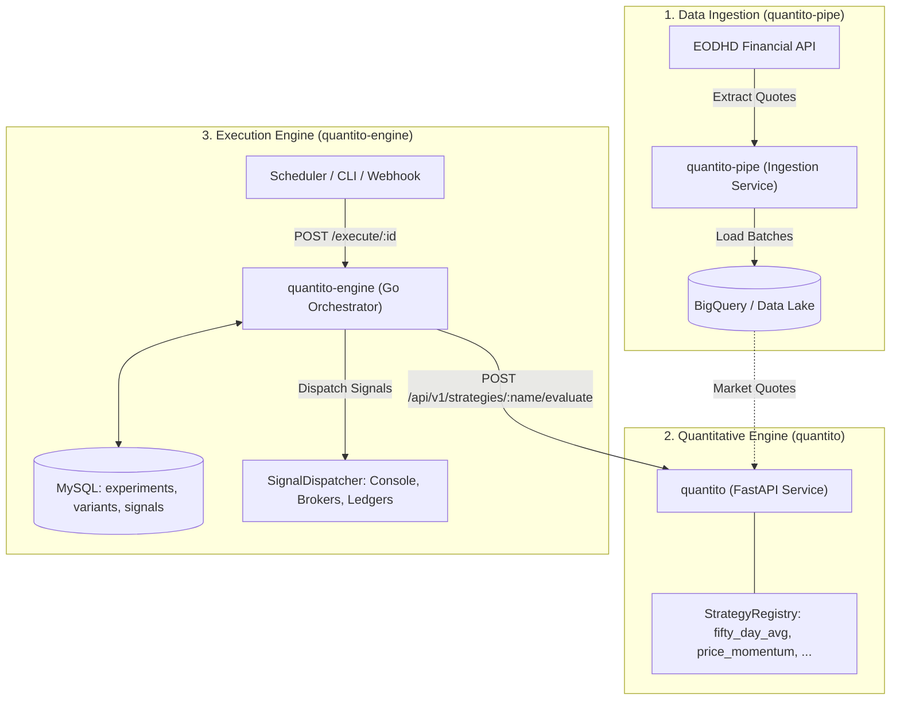

# Quantito Pipe (`quantito-pipe`)

**Quantito Pipe** is the dedicated market data ingestion and collection service of the **Quantito Financial Platform**. Built with Python 3.12+, it connects to financial market data APIs (EODHD) to extract, standardize, and load real-time, delayed, and End-of-Day (EOD) historical quotes into Google Cloud BigQuery.

---

## 1. Role in the Quantito Ecosystem

The **Quantito Platform** is split into three decoupled, specialized services:



| Service | Technology | Role |
| :--- | :--- | :--- |
| **`quantito-pipe`** *(this repo)* | Python / Cloud Run Job | Ingests market quotes (EOD, Delayed, Real-time) from EODHD into BigQuery. |
| **`quantito`** | Python 3.12 / FastAPI | Pure quantitative strategy evaluation service (`fifty_day_avg`, `price_momentum`). |
| **`quantito-engine`** | Go 1.22+ / Echo / MySQL | Experiment orchestrator, parallel contraposition, concurrency locks, signal ledger, and dispatcher. |

---

## 2. Ingestion Pipelines

`quantito-pipe` encapsulates three independent data pipelines configured to run as scheduled jobs (e.g. Cloud Run Jobs, Cron, Airflow):

1. **Real-Time Quotes (`real_time`)**:
   - Queries live price quotes for active ticker universes.
   - Ingests into BigQuery table `quotes_real_time`.
2. **US Delayed Quotes (`delayed`)**:
   - Fetches 15-minute delayed quotes from US market feeds.
   - Ingests into BigQuery table `quotes_delayed`.
3. **End-of-Day Historical Quotes (`eod`)**:
   - Downloads daily closing candles, volume, and moving average benchmarks.
   - Ingests into BigQuery table `quotes_eod`.

---

## 3. Storage Architecture

Market data is persisted in Google Cloud BigQuery:
- Automatic dataset and table schema provisioning upon execution.
- High-throughput batch streaming insertions using `google-cloud-bigquery`.
- Schema fields: `symbol`, `timestamp`, `close`, `high`, `low`, `open`, `volume`, and pipeline-specific indicator fields (such as `fifty_day_average_price`).

---

## 4. Configuration

Configured via environment variables or CLI flags:

| Variable | CLI Flag | Description | Default |
| :--- | :--- | :--- | :--- |
| `EODHD_API_TOKEN` | `--token` | EODHD API authentication token | *(Required)* |
| `BIGQUERY_DATASET` | `--dataset` | BigQuery target dataset name | `market_data` |
| `BIGQUERY_LOCATION`| `--location`| GCP region for BigQuery dataset | `US` |
| `SYMBOLS` | `--symbols` | Comma-separated ticker symbols | `AAPL.US,GOOGL.US` |
| `PIPELINES` | `--pipelines`| Pipelines to execute (`real_time`, `delayed`, `eod`) | `real_time,delayed,eod` |

---

## 5. Local Development & Testing

```bash
# 1. Create and activate virtual environment
python3 -m venv .venv
source .venv/bin/activate

# 2. Install package and development tools
pip install -e ".[dev]"

# 3. Linting and formatting checks
ruff check . && ruff format --check .

# 4. Run unit tests
python -m unittest discover tests

# 5. Execute pipelines locally
export EODHD_API_TOKEN="your_eodhd_token"
python main.py --symbols AAPL.US,MSFT.US --pipelines real_time,delayed
```

---

## 6. Docker Execution

```bash
# Build Docker image
docker build -t quantito-pipe:latest .

# Run container as a scheduled job
docker run --rm \
  -e EODHD_API_TOKEN="your_eodhd_token" \
  -e BIGQUERY_DATASET="market_data" \
  -e PIPELINES="real_time,delayed,eod" \
  quantito-pipe:latest
```
