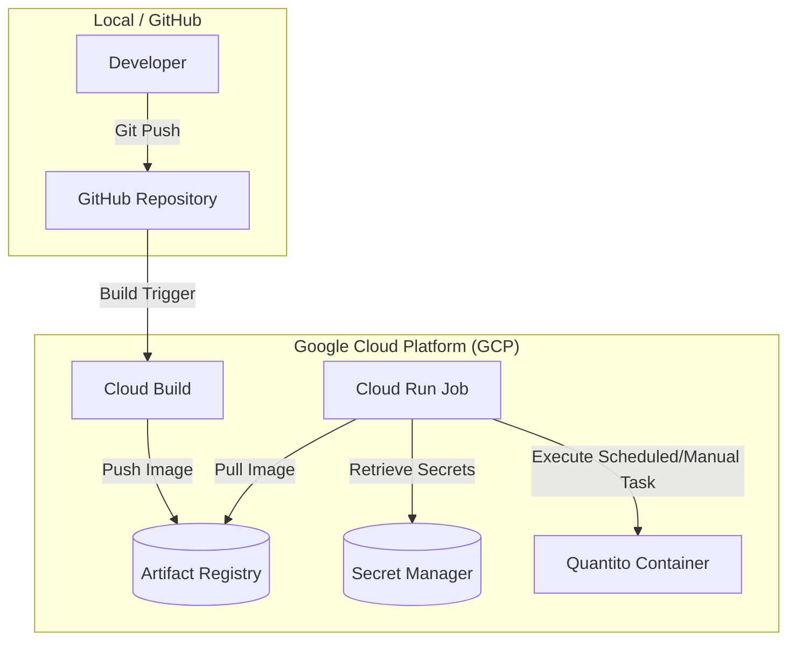

# Quantito Deployment on Google Cloud Platform (GCP)

This document details the infrastructure architecture, design decisions, and CI/CD configuration for deploying **Quantito** on Google Cloud Platform.

---

## 1. Infrastructure Architecture

The deployment of **Quantito** leverages the following Google Cloud services:

*   **Artifact Registry:** A private Docker registry for storing compiled container images of the application.
*   **Cloud Build:** A continuous integration and delivery (CI/CD) service connected to the GitHub repository, automating container image builds and storage.
*   **Google Cloud Run (Jobs):** Used to execute the container as a scheduled or on-demand run-to-completion task. The Python script performs data extraction and analysis and exits without needing a persistent web server process.
*   **Secret Manager:** Secure storage for sensitive credentials (such as `EODHD_API_TOKEN`), which are injected into the Cloud Run Job as environment variables during execution.

### Deployment and Execution Flow Diagram



---

## 2. Configuration History and Design Decisions

### Repository Connection and Permissions
We connected the Git repository (`leandrogutierrez148/quantito`) to Google Cloud Build. To adhere to security best practices and the principle of least privilege, access was strictly limited to this specific repository.

### Transitioning from Cloud Run Service to Cloud Run Job
**The Issue:** We initially configured a **Cloud Run Service**. However, container initialization kept failing because Cloud Run Services expect the container to actively listen for and serve HTTP traffic on a designated port (defaulting to `8080`). Since Quantito is a run-to-completion Python script, the container terminated immediately after finishing its execution, causing Cloud Run to flag the service as unhealthy and fail.

**The Solution:** We deleted the Cloud Run Service and set up a **Cloud Run Job** instead. Cloud Run Jobs are designed specifically for tasks and scripts that run to completion.

### CI/CD Pipeline Optimization (Cloud Build Trigger)
Upon inspecting the default build trigger generated automatically, we found that deployments failed at the final step: `Finished Step #3 - "Deploy"`.

The original trigger flow included a step to deploy directly as a Cloud Run Service, configured in the YAML with arguments in the form of `- run` and `- service`. To resolve this, we modified the trigger to remove this final direct deployment step, keeping only the build-related steps:
1. Pulling the most recent image version for caching (`docker pull`).
2. Building the new Docker image utilizing the cache (`docker build`).
3. Pushing the tags (`latest` and `$COMMIT_SHA`) to Artifact Registry (`docker push`).

By removing the automatic deployment step from the trigger, the image successfully builds on every commit and remains ready in Artifact Registry to be executed by the Cloud Run Job.

### Cloud Build Trigger Configuration

The following is the final YAML definition of the build trigger used in Cloud Build:

```yaml
steps:
  - name: gcr.io/cloud-builders/docker
    args:
      - '-c'
      - >-
        docker pull
        $_AR_HOSTNAME/$_AR_PROJECT_ID/$_AR_REPOSITORY/$REPO_NAME/$_SERVICE_NAME:latest
        || exit 0
    id: Pull
    entrypoint: /bin/bash
  - name: gcr.io/cloud-builders/docker
    args:
      - build
      - '--cache-from'
      - >-
        $_AR_HOSTNAME/$_AR_PROJECT_ID/$_AR_REPOSITORY/$REPO_NAME/$_SERVICE_NAME:latest
      - '-t'
      - >-
        $_AR_HOSTNAME/$_AR_PROJECT_ID/$_AR_REPOSITORY/$REPO_NAME/$_SERVICE_NAME:$COMMIT_SHA
      - '-t'
      - >-
        $_AR_HOSTNAME/$_AR_PROJECT_ID/$_AR_REPOSITORY/$REPO_NAME/$_SERVICE_NAME:latest
      - .
      - '-f'
      - Dockerfile
    id: Build
  - name: gcr.io/cloud-builders/docker
    args:
      - push
      - '--all-tags'
      - $_AR_HOSTNAME/$_AR_PROJECT_ID/$_AR_REPOSITORY/$REPO_NAME/$_SERVICE_NAME
    id: Push
images:
  - >-
    $_AR_HOSTNAME/$_AR_PROJECT_ID/$_AR_REPOSITORY/$REPO_NAME/$_SERVICE_NAME:$COMMIT_SHA
  - >-
    $_AR_HOSTNAME/$_AR_PROJECT_ID/$_AR_REPOSITORY/$REPO_NAME/$_SERVICE_NAME:latest
options:
  requestedVerifyOption: VERIFIED
  substitutionOption: ALLOW_LOOSE
  logging: CLOUD_LOGGING_ONLY
substitutions:
  _SERVICE_NAME: quantito-git
  REPO_NAME: leandrogutierrez148-quantito
  _TRIGGER_ID: 3cb0c0c5-f22b-49ef-9d04-1bb0df5f872f
  _DEPLOY_REGION: europe-west1
  _AR_HOSTNAME: europe-west1-docker.pkg.dev
  _AR_REPOSITORY: cloud-run-source-deploy
  _AR_PROJECT_ID: quantito
tags:
  - gcp-cloud-build-deploy-cloud-run
  - quantito-git
```

---

## 3. Cloud Run Job Definition (`quantito-git`)

The batch/task execution of Quantito is managed via a Google Cloud Run Job named `quantito-git`.

### Key Configuration Highlights

*   **Container Image:** Pulls the `:latest` image built by Cloud Build from Artifact Registry (`europe-west1-docker.pkg.dev/quantito/cloud-run-source-deploy/leandrogutierrez148-quantito/quantito-git:latest`).
*   **Environment Variables & Secret Manager Integration:**
    *   `BIGQUERY_DATASET`: Sets the destination dataset in BigQuery (e.g., `quantito_test`).
    *   `EODHD_API_TOKEN`: Injected securely directly from Secret Manager via `secretKeyRef` pointing to secret `eodhd-api_key` (version `1`).
*   **Resource Allocation:** Configured with `1000m` (1 vCPU) and `512Mi` RAM, providing lightweight and cost-effective execution.

### Cloud Run Job YAML Specification

```yaml
apiVersion: run.googleapis.com/v1
kind: Job
metadata:
  name: quantito-git
  namespace: '393621976174'
  labels:
    cloud.googleapis.com/location: europe-west1
    run.googleapis.com/lastUpdatedTime: '2026-07-25T09:08:32.377332Z'
  annotations:
    run.googleapis.com/creator: leandrogutierrez148@gmail.com
    run.googleapis.com/lastModifier: leandrogutierrez148@gmail.com
    run.googleapis.com/client-name: cloud-console
spec:
  template:
    metadata:
      annotations:
        run.googleapis.com/client-name: cloud-console
        run.googleapis.com/execution-environment: gen2
    spec:
      taskCount: 1
      template:
        spec:
          containers:
          - name: quantito-git-1
            image: europe-west1-docker.pkg.dev/quantito/cloud-run-source-deploy/leandrogutierrez148-quantito/quantito-git:latest
            env:
            - name: BIGQUERY_DATASET
              value: quantito_test
            - name: EODHD_API_TOKEN
              valueFrom:
                secretKeyRef:
                  key: '1'
                  name: eodhd-api_key
            resources:
              limits:
                cpu: 1000m
                memory: 512Mi
          maxRetries: 3
          timeoutSeconds: 600
          serviceAccountName: 393621976174-compute@developer.gserviceaccount.com
      delayExecution: false
```


