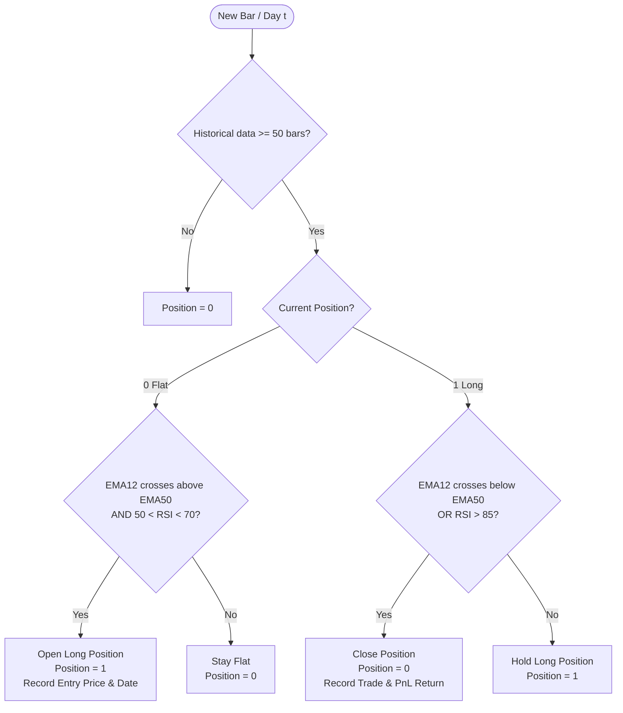

# Heuristic Strategy: EMA Crossover with RSI Momentum Filter

Technical and methodological documentation for the algorithmic trading strategy based on Exponential Moving Average (**EMA**) crossovers and the Relative Strength Index (**RSI**).

---

## 1. Executive Summary

The strategy combines two core pillars of quantitative technical analysis:
1. **Trend Following**: Utilizes the crossover of two Exponential Moving Averages (12-period and 50-period EMAs) to detect early shifts in the structural direction of asset prices.
2. **Momentum & Overbought Filter**: Employs a 14-period RSI to confirm that upward price momentum is sufficiently strong ($RSI > 50$) while avoiding purchases in exhausted or overbought conditions ($RSI \ge 70$). It also implements an emergency exit rule if extreme overbought conditions occur ($RSI > 85$).

---

## 2. Technical Indicator Definitions

### 2.1 Exponential Moving Average (EMA)
The EMA places greater weight and significance on the most recent price data points compared to a Simple Moving Average (SMA), thereby reducing temporal lag.

$$\text{EMA}_t = \alpha \cdot P_t + (1 - \alpha) \cdot \text{EMA}_{t-1}$$

Where:
*   $P_t$: Closing price at time/day $t$.
*   $\alpha$: Smoothing multiplier, defined as $\alpha = \frac{2}{N + 1}$.
*   **Fast EMA ($N = 12$)**: $\alpha \approx 0.1538$ (sensitive to short-term fluctuations).
*   **Slow EMA ($N = 50$)**: $\alpha \approx 0.0392$ (captures medium-term structural trend).

### 2.2 Relative Strength Index (RSI)
Measures the speed and change of price movements over a 14-period window on a scale from 0 to 100.

$$\text{RSI} = 100 - \frac{100}{1 + RS}, \quad \text{where } RS = \frac{\text{Average Gain (14 periods)}}{\text{Average Loss (14 periods)}}$$

---

## 3. Trading Logic and Execution Rules

### 3.1 Entry Conditions (Long Buy Signal)
A long position is opened ($Position = 1$) at the close of period $t$ if all of the following conditions are met simultaneously:

1. **State:** Current position = $0$ (out of market / flat).
2. **Bullish Crossover (Golden Cross):** The fast EMA crosses above the slow EMA:
   $$\text{EMA}_{12, t-1} \le \text{EMA}_{50, t-1} \quad \land \quad \text{EMA}_{12, t} > \text{EMA}_{50, t}$$
3. **RSI Momentum Confirmation:** The RSI falls within a healthy expansion zone:
   $$50 < \text{RSI}_t < 70$$

### 3.2 Exit Conditions (Sell / Close Position)
The position is closed ($Position = 0$) at the close of period $t$ if **at least one** of the following conditions is met:

1. **Bearish Crossover (Death Cross):** The fast EMA crosses below the slow EMA:
   $$\text{EMA}_{12, t-1} \ge \text{EMA}_{50, t-1} \quad \land \quad \text{EMA}_{12, t} < \text{EMA}_{50, t}$$
2. **Extreme Overbought Reversal:** The RSI exceeds the extreme exhaustion threshold:
   $$\text{RSI}_t > 85$$

---

## 4. Decision Flow Diagram



---

## 5. Backtesting Simulation & Quantitative Metrics

To accurately reflect realistic trading environments, performance evaluation incorporates transaction costs and key risk-adjusted metrics:

### 5.1 Transaction Frictions & Commissions
*   **Transaction Fee ($c$):** A $0.1\%$ ($0.001$) commission fee is applied on each position change (entry and exit):
    $$\text{Strategy Return}_t = \text{Position}_{t-1} \cdot \text{Market Return}_t - |\Delta \text{Position}_t| \cdot c$$

### 5.2 Evaluated Performance Metrics
*   **Cumulative Return:** Total compounded growth of the strategy compared against the benchmark (*Buy & Hold*).
*   **Annualized Sharpe Ratio:** Risk-adjusted performance relative to daily return volatility ($\times \sqrt{365}$ or $\sqrt{252}$).
*   **Maximum Drawdown (MDD):** Peak-to-trough decline before a new high is achieved on the cumulative wealth curve (*high-water mark*).
*   **Win Rate & Average Trade Return:** Percentage of profitable closed trades and the average expected percentage return per trade.

---

## 6. Python Reference Implementation

```python
import numpy as np
import pandas as pd


def calculate_indicators(df: pd.DataFrame) -> pd.DataFrame:
    """Calculates 12-period and 50-period EMAs and 14-period RSI."""
    df["ema_fast"] = df["close"].ewm(span=12, adjust=False).mean()
    df["ema_slow"] = df["close"].ewm(span=50, adjust=False).mean()

    delta = df["close"].diff()
    gain = (delta.where(delta > 0, 0)).rolling(window=14).mean()
    loss = (-delta.where(delta < 0, 0)).rolling(window=14).mean()

    rs = gain / (loss + 1e-9)
    df["rsi"] = 100 - (100 / (1 + rs))
    return df


def run_heuristic_strategy(df: pd.DataFrame):
    """Executes trading logic and maintains daily portfolio positions."""
    positions = []
    position = 0
    trades = []
    entry_price = 0.0
    entry_date = None

    for i in range(len(df)):
        if i < 50:
            positions.append(0)
            continue

        current_close = df["close"].iloc[i]
        curr_fast, curr_slow = df["ema_fast"].iloc[i], df["ema_slow"].iloc[i]
        prev_fast, prev_slow = df["ema_fast"].iloc[i - 1], df["ema_slow"].iloc[i - 1]
        current_rsi = df["rsi"].iloc[i]

        crossed_above = (prev_fast <= prev_slow) and (curr_fast > curr_slow)
        crossed_below = (prev_fast >= prev_slow) and (curr_fast < curr_slow)

        if position == 0:
            if crossed_above and (50 < current_rsi < 70):
                position = 1
                entry_price = current_close
                entry_date = df.index[i]
        elif position == 1:
            if crossed_below or (current_rsi > 85):
                position = 0
                pct_return = (current_close - entry_price) / entry_price
                trades.append(
                    {
                        "entry_date": entry_date,
                        "exit_date": df.index[i],
                        "entry_price": entry_price,
                        "exit_price": current_close,
                        "return": pct_return,
                    }
                )

        positions.append(position)

    df["position"] = positions
    return df, trades
```

---

## 7. Advantages, Limitations, and Future Improvements

### Key Advantages
*   **Simplicity & Interpretability:** Transparent, rule-based heuristics that can be audited and reproduced in real-time pipelines.
*   **Downside Protection:** Effective capital preservation in sustained bear markets by triggering timely exits during downward trend reversals.
*   **False Breakout Mitigation:** The $50 < RSI < 70$ constraint filters out weak crossovers lacking solid buying volume or momentum.

### Limitations
*   **Whipsawing in Range-Bound Markets:** Frequent false crossover signals and transaction fee drag during periods of sideways market consolidation.
*   **Static Parameters:** Fixed lookback windows ($12$, $50$, $14$) do not dynamically adjust to shifting market volatility regimes.

### Recommended Enhancements
1. **Dynamic Stop-Loss & Take-Profit:** Integrate the Average True Range (**ATR**) to dynamically scale risk and position stops according to market volatility.
2. **Continuous Position Sizing:** Transition from a binary exposure model ($0$ or $1$) to volatility-targeted or confidence-weighted position sizing.
3. **Walk-Forward Optimization:** Systematically calibrate RSI thresholds and EMA spans over rolling out-of-sample time horizons.
